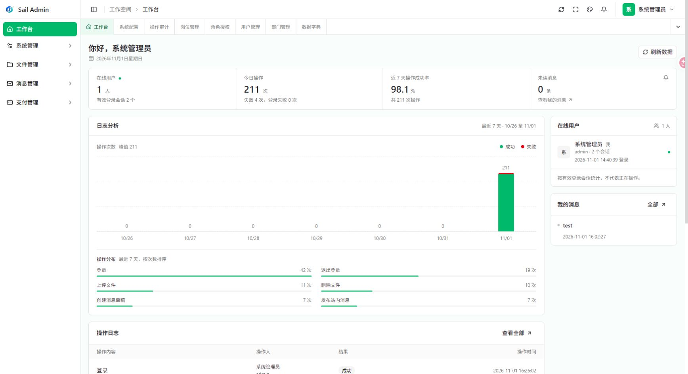
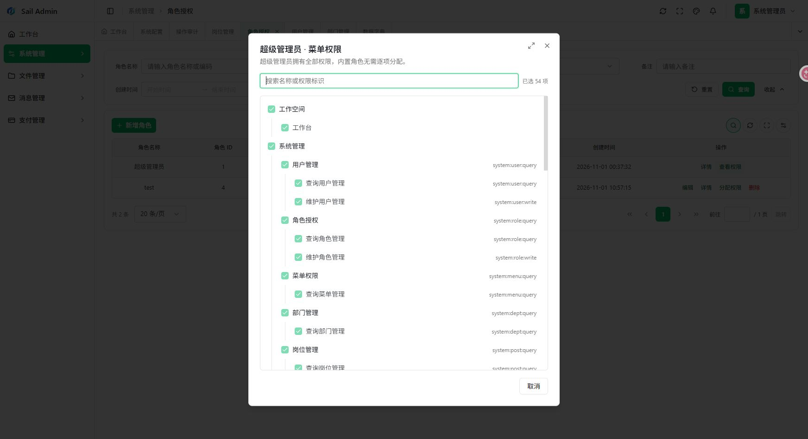
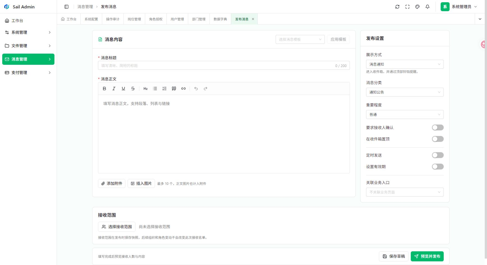
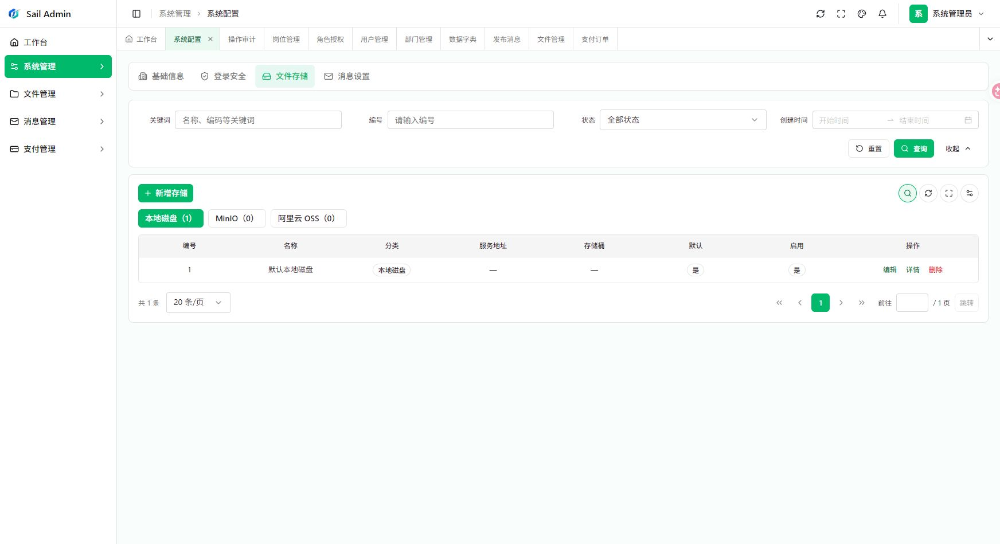

# Sail Admin

Sail Admin 是面向企业后台管理员和业务操作人员的管理系统基础工程，将账号权限、组织资料、站内消息、文件和扫码收款放在同一个后台中。管理员可以维护用户与授权、发布消息并查看送达回执、管理文件和存储配置；业务人员只能访问获授权的菜单与数据。页面读写真实后端接口，服务端再次校验权限和资源归属。

项目由 JDK 21 / Spring Boot 4 后端和 Vue 3 管理前端组成。后端采用 Maven 模块化单体，按 Controller、Service、Mapper 分层；前端通过 HTTP 与 WebSocket 接入。当前适合开发和本地验证，正式部署及外部支付、对象存储需要结合实际环境完成配置和联调。



> 以下图片于 2026-11-01 从当前本地运行的管理前端重新截取。页面中的统计、账号和文件来自截图时的本地环境，不代表其他部署环境的数据。

## 功能范围

| 模块 | 已实现的主要能力 |
| --- | --- |
| 系统管理 | 登录与锁定、会话下线、用户/角色/菜单按钮授权、部门和岗位、五类数据范围、字典、系统参数、登录与操作审计 |
| 定时任务 | Quartz JDBC 持久化、Cron/固定频率、启停/立即执行/归档、执行历史、有限重试、协作超时与失联处置；默认无启用任务 |
| 消息中心 | 模板和草稿、富文本及私有附件、按组织选择与排除收件人、预览人数、定时发布、分批投递、公告弹窗、回执与导出、阅读确认、归档、撤回和重试；WebSocket 提醒与数据库收件箱配合 |
| 文件管理 | 上传、鉴权预览和下载、归属校验、显式公开读取；本地磁盘、MinIO、阿里云 OSS 可配置多套实例，并选择新文件的默认存储 |
| 扫码支付 | 微信 Native、支付宝当面付、业务单号幂等、查单、关单、整单退款、回调验签、定时补偿和持久化业务通知 |
| 管理前端 | 工作台、个人中心（资料、昵称修改、密码）、权限导航、系统管理、消息、文件及支付页面；中英文界面、响应式布局、主题设置和可拖动/全屏的弹窗 |

典型使用顺序是：初始化管理员 → 建立部门、岗位和用户 → 配置角色的菜单权限与数据范围 → 由业务人员上传文件或发布消息 → 在工作台、消息回执和操作审计中查看结果。支付应用和渠道可随后接入具体业务订单；没有真实商户资料时，支付页面可管理配置和查看记录，但不能完成真实交易联调。

支付金额以人民币分为单位。业务模块应按自己的订单计算金额，并通过 `PaymentEventHandler` 幂等消费支付通知；未接入处理器时通知保留等待状态。当前不包含钱包、分账或部分退款。通用任务管理与执行记录现采用 Quartz JDBC；跨应用调度平台、多租户、邮件短信及 MFA 不在当前实现范围内。`sail-gateway` 只保留模块位置，首期无需独立启动。

## 界面展示

### 角色与权限

管理员在角色页面分配菜单和按钮权限，并选择全部、自定义部门、本部门、本部门及下级或仅本人五类数据范围。前端根据授权展示导航，后端仍在接口和数据查询时执行校验。



### 消息发布与公告

发布者可以保存草稿、选择模板和收件范围，预览实际人数后发布；发布记录保留投递、阅读和确认回执。需要主动展示的公告可在接收方页面弹出，展示记录与主动确认分别保存。



### 文件与存储

文件列表支持权限内的上传、预览、下载与删除。图片使用全屏预览；PDF、Word、Excel、Markdown 等按各自格式解析。历史文件仍从上传时记录的存储配置读取。



## 技术与目录

| 部分 | 当前基线 |
| --- | --- |
| 后端 | JDK 21、Spring Boot 4.0.9、Maven 3.9.11、MyBatis-Plus 3.5.18、Sa-Token 1.46.0 |
| 数据与缓存 | MySQL 8.4、Redis 7 为目标基线；开发环境支持配置中的旧 Redis 兼容模式 |
| 前端 | Vue 3、TypeScript、Vite 8、Tailwind CSS 4、shadcn-vue、Pinia；Node.js >= 22.15，pnpm 11.28.6 |

```text
sail-admin/
├── sail-dependencies/        # 第三方及内部模块版本管理
├── sail-common/              # core、web、test 公共能力
├── sail-framework/           # web、security、mybatis、redis、log、oss
├── sail-modules/             # system、message、file、pay、job；各含 api/server
├── sail-server/              # 单体启动入口、环境配置、基础 SQL
├── sail-gateway/             # 预留模块，不作为当前部署入口
├── sail-ui/                  # Vue 管理前端
├── scripts/                  # 本地启动及已有库增量脚本
├── deploy/app/               # 复制到生产 /app 的 Compose、组件配置与运维脚本
├── docs/                     # 接口资料、历史验收记录及页面截图
└── mvnw.ps1                  # 固定 Maven 3.9.11 的 PowerShell 入口
```

后端入口是 `sail.server.SailApplication`，可执行产物为 `sail-server/target/sail-server-1.0.0.jar`。`sail-server` 装配五个业务模块的 Server 实现；各 API 模块承载跨模块 Java 契约，Controller、实体和 Mapper 留在所属模块内。数据库保存业务事实，Redis 保存会话、临时票据及实时变化信号；消息收件箱与支付通知持久化，用于断线补读或失败重试。服务端控制权限和数据范围，前端隐藏无权限入口只是交互层处理。

## 本地启动

以下步骤在工程根目录执行，使用 PowerShell 7。MySQL、Redis 的安装和启动由操作者完成；应用不会自动创建数据库或导入 SQL。

1. 准备 JDK 21、PowerShell 7、MySQL 和 Redis。配置 `JAVA_HOME` 指向 JDK 21，并准备空的 `sail_admin` 数据库。目标中间件版本为 MySQL 8.4 / Redis 7；如使用其他版本，需单独验证兼容性。
2. **仅对全新空库**人工导入 [`base.sql`](sail-server/src/main/resources/db/base.sql)。当前脚本包含 41 张表、基础角色、权限、配置和默认本地存储。`spring.sql.init.mode=never`，应用启动不执行建表或迁移。已有库按[数据库升级](#数据库升级)处理，不重复导入基础脚本。
3. 检查 [`application-local.yaml`](sail-server/src/main/resources/application-local.yaml) 的 MySQL、Redis、初始管理员、AES 主密钥和本地存储目录，使其与自己的开发环境一致。开发配置直接读取 YAML，不依赖 `.env` 或 `SAIL_*` 变量。初始管理员配置仅在账号不存在时生效，不会覆盖已有密码。
4. 构建并启动后端：

```powershell
.\mvnw.ps1 '-Dmaven.test.skip=true' clean package
.\scripts\run-local.ps1
```

`mvnw.ps1` 首次运行会下载并校验 Maven 3.9.11。启动脚本要求 PowerShell 7，以工程根目录为工作目录，并设置 JVM 时区为 `Asia/Shanghai`。需要只为本次启动指定 JDK 时，可使用 `.\scripts\run-local.ps1 -JavaHome 'C:\path\to\jdk-21'`。Windows 下重新打包前，先停止正在使用目标 JAR 的进程。

5. 新开一个终端，安装依赖并启动前端：

```powershell
if (-not (Test-Path sail-ui/.env.local)) { Copy-Item sail-ui/.env.example sail-ui/.env.local }
Set-Location sail-ui
corepack pnpm install --frozen-lockfile
corepack pnpm dev --host localhost
```

前端示例配置的 `SAIL_BACKEND_URL` 指向 `http://127.0.0.1:8081`。开发服务默认使用 `http://localhost:5173`，将 `/api` 和 `/ws` 代理到该地址。若已有本地 `.env.local`，先核对代理目标，不要覆盖自己的配置；Vite 改动环境文件后需重启。实际访问域名或端口也须与后端 `sail.websocket.allowed-origins` 一致。

后端公共配置在 local 环境默认监听 **8081**，生产 profile 配置为 **8080**。若本机同时运行 IDE 后端和旧 JAR，应先确认前端代理指向哪个进程，避免两个进程使用同一数据库执行后台任务。浏览器入口为 `http://localhost:5173/auth/sign-in`；开发管理员用户名和首次密码以本地 YAML 的 `sail.bootstrap` 为准。

启动后可检查 `http://127.0.0.1:8081/actuator/health`，正常时返回 `UP`。登录接口是 `POST /api/system/auth/login`；后续接口使用 `Authorization: Bearer <登录返回的 tokenValue>`。普通 JSON 接口返回 `code`、`message`、`data` 和 `traceId`，列表从 `page=1` 开始分页。消息 WebSocket 使用登录后获取的短期一次性票据，断线后重新获取票据并查询收件箱。完整请求字段与权限见[接口文档](docs/api.md)；其中历史示例使用的 `baseUrl` 应按本地实际监听端口设置。

## 配置与数据

| 环境 | 配置文件 | 使用方式 |
| --- | --- | --- |
| local | `sail-server/src/main/resources/application-local.yaml` | 默认 profile；开发连接、主密钥、初始管理员和本地目录直接配置 |
| test | `sail-server/src/test/resources/application-test.yaml` | 测试显式启用；测试资源不进入生产 JAR |
| prod | `sail-server/src/main/resources/application-prod.yaml` | 显式启用；连接、密钥、存储目录、WebSocket 来源等需独立填写，当前空值不能直接用于生产 |

`sail.security.master-key` 用于支付和存储敏感配置的 AES-256-GCM 加密。已有密文时不得直接替换主密钥；应连同数据库与文件一起备份，并在迁移时保持可解密性。用户密码保存在 `sys_user_credential`，使用 BCrypt 完整哈希和独立盐列，与 AES 主密钥无关。

本地文件默认写入 `./storage/<存储配置编号>/`。每种存储类型可配置多套实例，但新上传只使用一个选中的默认实例；切换默认值不移动历史文件，历史文件仍按原配置读取。普通文件默认私有，只有显式标记公开的对象可匿名读取；上传单文件上限为 20 MiB。文件归属和消息附件访问在后端校验。

采用逻辑删除的业务表约定是 `deleted=0` 表示有效，删除时写入该行 `id`。数据库是业务事实来源；Redis 用于会话、临时票据和通知等。系统配置中的站点信息和登录策略与支付、存储秘密分开管理。

## 数据库升级

[`base.sql`](sail-server/src/main/resources/db/base.sql) 只用于全新空库，已包含当前结构；已有库先备份，再检查实际表结构和已执行的变更，只应用缺失的增量脚本一次。MySQL DDL 不可按普通事务整体回滚，失败后应检查当前结构，不能盲目重跑整个文件。

| 脚本 | 适用的已有库场景 |
| --- | --- |
| [`20261103-job-scheduler.sql`](scripts/migrations/20261103-job-scheduler.sql) | 尚未创建通用任务与 Quartz 表的已有库；先备份，仅执行一次 |
| [`20261104-merge-workflow-pages.sql`](scripts/migrations/20261104-merge-workflow-pages.sql) | 已完成消息中心与定时任务迁移的旧库；将发布消息、执行记录收进对应工作流，保留原权限和角色授权 |
| [`20261101-role-remark.sql`](scripts/migrations/20261101-role-remark.sql) | `sys_role` 缺少 `remark` 字段 |
| [`20261101-admin-management.sql`](scripts/migrations/20261101-admin-management.sql) | 旧版缺少字典类型、审计扩展或菜单图标等管理结构 |
| [`20261101-message-center.sql`](scripts/migrations/20261101-message-center.sql) | 尚未创建消息发布任务、接收快照等消息中心结构 |
| [`20261101-message-preview.sql`](scripts/migrations/20261101-message-preview.sql) | **已经完成**消息中心升级，但尚无主动弹窗公告字段 |

旧版若仍在 `sys_user` 保存密码材料，还需先完成凭据分表迁移；当前仓库未提供该迁移脚本，不能仅靠上述文件完成这类旧库升级。以上脚本也不是可对任意旧库依次无条件执行的升级器。迁移前须备份数据库、存储目录和 AES 主密钥；升级失败后核对表结构及数据，再决定恢复或补齐步骤。

## 本次优化与实施说明

- [消息连接原因分析与生产排查](docs/message-connection-diagnosis-20261103.md)：区分实时连接与 HTTP 补读故障，心跳与状态恢复修复需前后端配套升级。
- [定时任务与执行记录选型评审](docs/scheduler-selection-review-20261103.md)：已批准并实现首期通用能力，详见[任务管理与运维说明](docs/job-scheduler.md)与[交付验收](docs/job-scheduler-acceptance-20261103.md)。
- 右上角个人菜单进入“个人中心”，可查看组织与账号资料、修改昵称及密码；主区域切换增加过渡并保留标签缓存，系统减少动态效果设置下禁用过渡。

## 开发与验证

后端完整测试、打包及前端静态检查可分别执行：

```powershell
# 工程根目录；执行后端测试与打包
.\mvnw.ps1 test
.\mvnw.ps1 '-DskipTests' package

# sail-ui 目录
corepack pnpm lint
corepack pnpm test:run
corepack pnpm build
```

`-Dmaven.test.skip=true` 会跳过测试代码编译与执行，适合仅需快速构建产物的场景；`-DskipTests` 仍编译测试代码。前端 `build` 包含 `vue-tsc` 类型检查和 Vite 构建。上述命令是复验入口，本次 README 编辑没有重新执行业务测试。仓库已有自动测试与本地页面验收记录，但真实微信/支付宝商户交易、MinIO/阿里云 OSS 读写、目标版本中间件及正式生产部署仍需分别验证。

## 生产部署

目标服务器为 Debian/Ubuntu x86_64。MySQL 8.4、Redis 7、Nginx 和一个 Sail Admin 后端实例由 [Compose](deploy/app/projects/compose.yaml) 运行；操作者负责安装 Docker Engine / Compose 插件、构建并传输产物、执行脚本。公网 IPv4 或域名均可通过 HTTP 访问，证书仅在启用 HTTPS 时需要。公网 HTTP 登录会明文传输账号和密码，应在服务器或云防火墙只允许管理人员的来源 IP 访问 80 端口，不能把它当作安全的正式入口。生产前端为静态文件，不在服务器安装 Node.js；后端镜像只需要预先构建的 JAR。

### 目录与持久化

将仓库的 `deploy/app/` 内容复制到目标机 `/app/`。部署包只带配置和脚本；运行时数据、证书、密钥、构建产物留在目标服务器。

```text
/app
├── docker/daemon.json                      # Docker 数据根目录样例
├── data/                                    # Docker 镜像、容器及运行日志
├── projects/
│   ├── .env                                # HTTP/HTTPS 与公开 IP/域名
│   ├── compose.yaml                        # 四个服务的唯一编排文件
│   ├── nginx/templates/                    # IP/域名 HTTP 与可选 HTTPS 入口
│   ├── nginx/site.conf                     # 静态资源、API 和 WS 共用代理
│   ├── mysql/conf.d/                        # MySQL 字符集和时区
│   ├── redis/redis.conf                     # RDB + AOF；ACL 在 redis/secrets/
│   └── sailadmin/                           # Dockerfile、外部 YAML、manage.sh
│       ├── sail-server-1.0.0.jar            # 本地打包后上传的后端 JAR
│       ├── dist/                            # 本地构建后上传的前端文件
│       ├── base.sql                         # 仅首次初始化空库需要
│       └── secrets/                         # AES 主密钥和管理员首次密码
├── volumes/
│   ├── mysql/data/                          # MySQL 数据文件
│   ├── redis/data/                          # dump.rdb 与 appendonlydir/ 整体
│   ├── nginx/certs/                         # fullchain.pem、privkey.pem
│   └── sailadmin/storage/                   # 上传文件
├── logs/nginx/、logs/sailadmin/              # 自定义访问与应用日志
└── backups/sailadmin/                       # SQL、Redis、文件和配置的备份
```

MySQL 与 Redis 不映射宿主机端口，并且只接入后端所在的数据网络；Nginx 只接入前后端网络。HTTP 模式由 80 端口提供页面，HTTPS 模式由 80 跳转到 443；Compose 中 443 端口虽始终映射，HTTP 模式没有 HTTPS 监听。`/api/`、`/ws/` 由 Nginx 保留原路径代理到后端 8080；`/actuator/` 不对公网开放。Redis 7 的 AOF 由多个文件组成，恢复时必须保持同一次备份中的 `appendonlydir/` 完整，不得拼接不同时间的 AOF 与 `dump.rdb`。

### 安装与首次准备

目标机只需 Docker Engine、`docker-buildx-plugin`、`docker-compose-plugin`、`openssl` 和 `util-linux`。MySQL、Redis、Nginx 由 Compose 拉取镜像；后端的 **JRE 21 已在 [`Dockerfile`](deploy/app/projects/sailadmin/Dockerfile) 中使用 `eclipse-temurin:21-jre-jammy`**，服务器不安装 Maven、JDK、Node.js 或 pnpm。新装 Docker 时按 [Debian 官方指南](https://docs.docker.com/engine/install/debian/) 或 [Ubuntu 官方指南](https://docs.docker.com/engine/install/ubuntu/) 配置 Docker 软件源并安装上述插件，检查 `docker compose version`。首次设置 Docker 数据根目录前，先检查 `/etc/docker/daemon.json` 和已有 Docker 数据；已有配置需要人工合并，不能直接覆盖或丢弃原数据。合并后的配置应包含 `"data-root": "/app/data"`，样例在 [`daemon.json`](deploy/app/docker/daemon.json)。重启 Docker 后确认 `docker info --format '{{.DockerRootDir}}'` 输出 `/app/data`。

把部署包复制到 `/app` 后，以 root 在目标机执行：

```bash
sudo bash /app/projects/sailadmin/manage.sh prepare
sudoedit /app/projects/.env
```

`prepare` 只在秘密文件不存在时生成 MySQL root/业务账号密码、Redis 密码、Base64 32 字节 AES 主密钥和首次管理员密码；重复运行不会轮换它们。它也创建持久化目录，设定应用目录权限，并从 Redis 密码生成 ACL 哈希。公开入口一次选择一种：无论使用公网 IP 还是域名，HTTP 模式均填 `SAIL_SCHEME=http`、`SAIL_PUBLIC_HOST=<实际 IP 或域名>`，不需要证书。只有启用 HTTPS 时才把域名证书链和私钥放到 `/app/volumes/nginx/certs/fullchain.pem`、`privkey.pem`，`check` 会检查域名、有效期和密钥配对。

| 访问方式 | `SAIL_SCHEME` | `SAIL_PUBLIC_HOST` | 证书 |
| --- | --- | --- | --- |
| 公网 IP 直连 | `http` | 服务器实际公网 IPv4 | 不需要 |
| 域名直连 | `http` | 实际域名 | 不需要 |
| 域名 HTTPS | `https` | 实际域名 | 需要匹配的证书链和私钥 |

`prepare` 还会将 `/app/projects/mysql/conf.d/sailadmin.cnf` 设为 `0644`。MySQL 会忽略可被所有用户写入的配置文件；首次导入时脚本与 `base.sql` 均显式使用 `utf8mb4`，避免中文种子数据按错误客户端字符集入库。配置权限变更后，已运行的 MySQL 容器要重启才能重新读取服务端配置。

生产配置在 [`application-prod.yaml`](deploy/app/projects/sailadmin/application-prod.yaml)：MySQL、Redis 使用 Compose 内部主机名，敏感字段由 Docker secrets 以 Spring Config Tree 注入。WebSocket 来源由 `SAIL_SCHEME` 和 `SAIL_PUBLIC_HOST` 生成；切换公开入口后须重建后端与 Nginx 容器。密钥、密码、证书和 `/app/projects/.env` 均不可提交到 Git。初始管理员密码在 `/app/projects/sailadmin/secrets/admin_password`，登录后应立即更改；后续启动不会重置管理员密码。已产生加密配置后不得随意轮换 AES 主密钥，否则旧数据无法解密。

### 首次上线

1. **本地打包。** 在仓库根目录使用 PowerShell 7，准备 JDK 21、Node.js >= 22.15。前端生产构建显式使用同源 `/api`；`SAIL_BACKEND_URL` 仅用于开发代理。

```powershell
.\mvnw.ps1 '-DskipTests' package
Push-Location sail-ui
corepack pnpm install --frozen-lockfile
$env:VITE_SERVER_API_URL = ''
$env:VITE_SERVER_API_PREFIX = '/api'
corepack pnpm build
Pop-Location
tar -czf sailadmin-deploy.tar.gz -C deploy/app .
tar -czf sailadmin-dist.tar.gz -C sail-ui/dist .
```

2. **上传文件。** 在本地 PowerShell 中把 SSH 地址填入 `$Server`，传到目标机 `/tmp/`。SQL 仅用于第一次空库初始化；以后只上传变动的 JAR、前端包和确实需要的增量迁移脚本。服务器不需要拉取源码。

```powershell
$Server = '<SSH用户>@<服务器地址>'
scp .\sailadmin-deploy.tar.gz "${Server}:/tmp/"
scp .\sailadmin-dist.tar.gz "${Server}:/tmp/"
scp .\sail-server\target\sail-server-1.0.0.jar "${Server}:/tmp/"
scp .\sail-server\src\main\resources\db\base.sql "${Server}:/tmp/"
```

3. **安装并设置 Docker。** 新的 Debian/Ubuntu x86_64 服务器可按以下命令添加 Docker 官方软件源。已有 Docker 时先核对版本和数据目录，跳过安装，不能直接覆盖已有配置或数据。

```bash
. /etc/os-release
sudo apt-get update
sudo apt-get install -y ca-certificates curl openssl util-linux
sudo install -m 0755 -d /etc/apt/keyrings
sudo curl -fsSL "https://download.docker.com/linux/$ID/gpg" -o /etc/apt/keyrings/docker.asc
sudo chmod a+r /etc/apt/keyrings/docker.asc
printf 'deb [arch=%s signed-by=/etc/apt/keyrings/docker.asc] https://download.docker.com/linux/%s %s stable\n' "$(dpkg --print-architecture)" "$ID" "$VERSION_CODENAME" | sudo tee /etc/apt/sources.list.d/docker.list > /dev/null
sudo apt-get update
sudo apt-get install -y docker-ce docker-ce-cli containerd.io docker-buildx-plugin docker-compose-plugin
sudo docker compose version
```

将部署包解压到 `/app`。如果是全新 Docker 环境且 `/etc/docker/daemon.json` 不存在，执行以下命令；已有 Docker 数据时先人工合并和迁移，不能直接覆盖。

```bash
sudo mkdir -p /app
sudo tar -xzf /tmp/sailadmin-deploy.tar.gz -C /app
sudo install -D -m 0644 /app/docker/daemon.json /etc/docker/daemon.json
sudo systemctl restart docker
sudo docker info --format '{{.DockerRootDir}}'
```

最后一行应为 `/app/data`。首次执行 `sudo bash /app/projects/sailadmin/manage.sh prepare`，它会生成 MySQL/Redis 密码、AES 主密钥和初始管理员密码，并创建 `/app/volumes`、`/app/logs`、`/app/backups` 下的对应目录。随后编辑 `/app/projects/.env`：HTTP 访问填 `SAIL_SCHEME=http`，`SAIL_PUBLIC_HOST` 填浏览器实际访问的服务器公网 IPv4 或域名，不填写协议、端口或示例域名。

4. **放置产物。** JAR 直接放 `/app/projects/sailadmin/sail-server-1.0.0.jar`，前端放 `/app/projects/sailadmin/dist/`；`dist` 中应直接包含 `index.html`，不能多一层 `dist/`。首次空库初始化另需上传 `base.sql`。如果 JAR 已经在指定位置，不必再复制一次。

```bash
sudo install -d -m 0755 /app/projects/sailadmin/dist
sudo install -m 0644 /tmp/sail-server-1.0.0.jar /app/projects/sailadmin/sail-server-1.0.0.jar
sudo install -m 0644 /tmp/base.sql /app/projects/sailadmin/base.sql
sudo tar -xzf /tmp/sailadmin-dist.tar.gz -C /app/projects/sailadmin/dist
```

5. **启动完整链路。** `check` 验证目录、秘密、公开访问方式和 Compose；HTTPS 模式额外检查证书。`init-db` 先启动 MySQL/Redis，并且只向空库导入 `base.sql`；`deploy` 把本地上传的 JAR 包装为含 JRE 21 的后端镜像，启动后端，再由 Compose 启动 Nginx。Nginx 依赖后端地址，不能在首次部署时先于后端单独启动。

```bash
sudo bash /app/projects/sailadmin/manage.sh check
sudo bash /app/projects/sailadmin/manage.sh init-db
sudo bash /app/projects/sailadmin/manage.sh deploy
sudo docker compose --env-file /app/projects/.env -f /app/projects/compose.yaml ps
sudo docker compose --env-file /app/projects/.env -f /app/projects/compose.yaml logs --tail=200 sailadmin nginx
```

浏览器访问 `<SAIL_SCHEME>://<SAIL_PUBLIC_HOST>/`。Nginx 提供 `dist`，把 `/api/` 和 `/ws/` 转发到 Compose 内的后端 `sailadmin:8080`；后端通过内部数据网络连接 `mysql:3306` 和 `redis:6379`。核对登录、权限、消息、WebSocket 重连、文件上传/预览/下载。`init-db` 失败后可能留下部分表，不能直接重跑；支付和云存储的公网回调仍需 HTTPS 域名与真实商户资料后另行联调。

如果旧版配置曾因权限过宽被 MySQL 忽略，并且中文种子数据已出现乱码，先确认库中没有必须保留的业务数据。更新 `/app` 部署包并确认正确的 `base.sql` 已在 `/app/projects/sailadmin/base.sql` 后，执行 `sudo bash /app/projects/sailadmin/manage.sh prepare` 修正配置权限，再运行 `sudo bash /app/projects/sailadmin/manage.sh reset-db --confirm-empty`。该命令先备份当前库、Redis 和上传文件，再删除并重建**仅 `sail_admin` 数据库**、以 `utf8mb4` 导入基础 SQL、清除该独立 Redis 实例的 0 号库，并重新启动应用。它会删除当前数据库记录；已有需保留的数据时不能使用。完成后重新登录，核对岗位名称与菜单中文。

### 访问入口切换

已有域名但不配置证书时，将 DNS A 记录指向服务器公网 IP，确认解析生效且 80 端口允许访问。编辑 `/app/projects/.env`，保留 `SAIL_SCHEME=http`，仅把 `SAIL_PUBLIC_HOST` 从 IP 改成实际域名，然后运行：

```bash
sudo bash /app/projects/sailadmin/manage.sh check
sudo bash /app/projects/sailadmin/manage.sh switch-origin
```

访问 `http://<实际域名>/`；消息连接使用同域名的 `ws://`。该切换只重建后端和 Nginx 容器，不重新导入数据库，也不要求重新打包 JAR 或 `dist`。浏览器从 IP 切到域名属于不同来源，需要重新登录。HTTP 不加密，后台账号密码及会话信息会在网络上传输明文。

若要从域名切回公网 IP，将 `/app/projects/.env` 设为 `SAIL_SCHEME=http`、`SAIL_PUBLIC_HOST=<服务器实际公网 IPv4>`，再执行相同的 `check` 和 `switch-origin` 命令。三种入口择一使用；切换后按新地址重新登录。

以后若启用 HTTPS，再完成以下证书步骤。

先将域名的 DNS A 记录指向服务器公网 IP，确认解析生效，再取得覆盖该域名的证书链与私钥。将实际证书文件安装到固定位置，私钥仅允许 root 读取；同时在服务器或云防火墙开放 443：

```bash
sudo install -m 0644 /实际证书链文件路径 /app/volumes/nginx/certs/fullchain.pem
sudo install -m 0600 /实际私钥文件路径 /app/volumes/nginx/certs/privkey.pem
```

编辑 `/app/projects/.env`，把 `SAIL_SCHEME` 改为 `https`、`SAIL_PUBLIC_HOST` 改为实际域名。运行：

```bash
sudo bash /app/projects/sailadmin/manage.sh check
sudo bash /app/projects/sailadmin/manage.sh switch-origin
```

`switch-origin` 使用当前已经构建的 JAR 镜像，只重建后端和 Nginx 容器，使 WebSocket 来源与 HTTPS 代理同时切换；MySQL、Redis、上传文件和数据库不重新初始化，JAR 与 `dist` 不用再次打包。验证 `https://<实际域名>/` 的登录、API 和 `wss://<实际域名>/ws/messages`，再更新支付回调等外部入口。浏览器从 IP 切到域名属于不同来源，用户需要重新登录。HTTPS 模板会把 80 端口请求跳转到 443。

### 后续更新与回滚

更新前先运行 `sudo bash /app/projects/sailadmin/manage.sh backup`。脚本暂停入口和后端写入，导出 MySQL，停止 Redis 后复制整套 RDB/AOF、上传文件、当前 JAR、`dist/`、秘密和配置到 `/app/backups/sailadmin/<备份目录名>/`，然后恢复服务。**备份成功后才覆盖固定路径的产物**；备份目录含敏感材料，只允许 root 访问，还应复制到独立介质并定期演练恢复。

本地重新打包变动部分并上传到服务器 `/tmp/`。只改后端时，直接用 `sudo install -m 0644 /tmp/sail-server-1.0.0.jar /app/projects/sailadmin/sail-server-1.0.0.jar` 替换 JAR；只改前端时，将新的 `dist` 内容解压到 `/app/projects/sailadmin/dist/`；两者都改则都替换。更新前端文件期间先停 Nginx 和后端，避免浏览器读取到一半新、一半旧的静态文件：

```bash
sudo docker compose --env-file /app/projects/.env -f /app/projects/compose.yaml stop nginx sailadmin
sudo install -m 0644 /tmp/sail-server-1.0.0.jar /app/projects/sailadmin/sail-server-1.0.0.jar
sudo tar -xzf /tmp/sailadmin-dist.tar.gz -C /app/projects/sailadmin/dist
sudo bash /app/projects/sailadmin/manage.sh check
sudo bash /app/projects/sailadmin/manage.sh deploy
```

上例同时更新前后端；只更新一侧就省略另一侧的替换命令。`deploy` 从固定路径的 JAR 构建 `sailadmin:prod`，重建后端与 Nginx；不再执行 `init-db`。若本次涉及数据库变更，应先按[数据库升级](#数据库升级)核对结构并执行对应增量脚本；MySQL DDL 失败后先核查当前结构。需要回滚时，运行 `sudo bash /app/projects/sailadmin/manage.sh rollback <备份目录名>`，脚本先保存当前状态，再从指定备份恢复 JAR 与 `dist` 并重建容器。回滚前须确认旧应用兼容当前数据库；脚本**不会自动恢复数据库**。确需恢复数据时，应停写后成套恢复同一时间点的 SQL、上传文件、Redis 目录和 AES 主密钥，恢复会丢失该时间点之后的写入。

## 来源与许可

- 后端模块拆分参考 [RuoYi Office](https://github.com/yuqing2026/ruoyi-office) 的 `master-jdk17` 提交 `ad56d726368d8c321644d47898a76d3e86f1b548`；本工程按已确认范围重新实现，原 MIT 文本保存在 `licenses/ruoyi-office-MIT.txt`。
- 前端基于 [shadcn-vue-admin](https://github.com/Whbbit1999/shadcn-vue-admin) 的 `main` 分支快照 `31a71ec84d8154486f32755a9e2ab761031a242c`。上游说明保存在 `sail-ui/README.upstream.md`，`sail-ui/LICENSE` 保留 `Copyright (c) 2024 Whbbit1999` 及 MIT 原文，分发时必须随附。
- 登录背景 GhostFibers 来自用户提供的 [Vue Bits](https://vue-bits.dev/) 实现，版权归 David Haz（2025），适用 **MIT + Commons Clause License Condition v1.0**，原文在 `licenses/vue-bits-LICENSE.md`。该许可允许作为应用的一部分使用，但限制出售、再许可或再分发组件本身，包括组件集合、模板或移植版；将本工程作为框架或模板分发前须核对授权。背景使用的 `ogl` 遵循其 npm 发布包内许可证。
- 文件预览使用 PDF.js（Apache-2.0）、Mammoth（BSD-2-Clause）、ExcelJS（MIT）、Marked（MIT）、Apache POI（Apache-2.0）及 vue-easy-lightbox（MIT）；富文本使用 Tiptap（MIT）。Lucide 图形遵循其包内许可，动态图标参考 Lucide Animated 的交互方式但未引入 React 组件。Spring、MyBatis-Plus、Sa-Token、支付及对象存储 SDK 等仍遵循各自发布包许可证；发行前按最终依赖清单核对版权、许可和 NOTICE。
