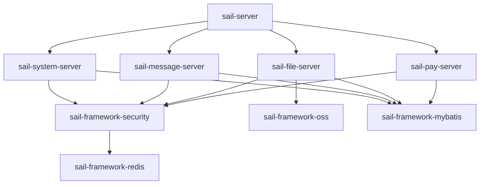

# Sail Admin 首期架构

本工程采用 JDK 21、Spring Boot 4 的 Maven 模块化单体，普通 Controller → Service → Mapper 三层架构。

## 已确认范围

- system：登录、会话、用户、角色、菜单及按钮权限、部门、岗位、数据权限、字典、配置、审计。
- message：模板、站内消息、已读状态、未读统计、WebSocket 提醒。
- file：上传下载、元数据、私有访问；多个本地、MinIO、阿里云 OSS 配置，按类型分组；默认本地，可切换默认配置。文件保存原配置编号。
- pay：微信 Native、支付宝当面付；支付、查单、关单、退款、验签回调、状态补偿和业务通知记录。

## 依赖方向

启动模块装配业务 Server；Server 只通过其他模块 API 调用业务。API 只放跨模块 Java 契约，HTTP Controller、Entity、Mapper 均留在 Server。首期没有远程 RPC、注册中心或外部任务调度中心。

## 关键边界

数据库是业务事实来源。Redis 保存登录状态和临时票据；定时补偿使用数据库条件更新与租约防止多实例重复执行。权限以服务端校验为准。交易金额统一使用最小货币单位的整数，渠道适配负责精确转换。

存储与支付敏感配置由环境提供的 AES-256 主密钥加密，列表与详情均不返回明文秘密。修改配置必须明确提供新秘密，不能用脱敏占位符覆盖。

用户资料与密码凭据物理分表：`sys_user` 保存账号资料与锁定状态，`sys_user_credential` 单独保存标准 BCrypt 完整编码和盐前缀。普通账号及后续改密通过 SecureRandom 生成 128 位随机盐；开发初始管理员使用 YAML 中专属随机盐，盐唯一键防止两个凭据复用同一盐；成本参数为 12。盐列与完整哈希前缀必须一致，认证不从用户资料表读取任何密码材料。用户创建、重置、删除与凭据变更共用事务，并发改密以原哈希条件更新检测冲突；响应视图不暴露凭据。AES 主密钥不作为用户密码盐。

## 环境与验证

生产环境使用 MySQL 8.4、Redis 7。中间件安装部署由人工进行。新库由人工导入 `sail-server/src/main/resources/db/base.sql`，应用不自动初始化，不再使用 Flyway。所有表与字段包含中文备注；统一 `deleted=0` 有效、`deleted=id` 删除，关系表采用独立主键保留历史授权。支付幂等键保持全局唯一。单元测试、应用集成测试和真实渠道联调分别记录结果；本轮按用户要求不执行。前端 `sail-ui` 使用同源 `/api` 和 `/ws` 接入，详见 [前端接入](frontend-integration.md)。

## 后续拆分

先将目标业务 Server 作为独立启动应用部署，再为已有 Java API 增加 HTTP 适配和鉴权；只在届时引入远程调用与网关。拆分前处理跨模块事务、数据归属、幂等和失败补偿，不直接共享 Mapper。

## API、HTTP 与自动配置

跨模块 API 只有 `UserDirectory`、`FileLookup`、`MessageSender`、`PaymentEventHandler` 等需要的 Java 契约，API 不依赖 Boot/数据库/Redis。站内消息通过 `system-api` 批量验证有效用户，支付模块不依赖系统 Server 或具体业务 Server；业务主动实现支付事件接口。

HTTP DTO 和 Controller 留在业务 Server；Controller 处理校验、鉴权和响应，查询写入均通过 Service，Mapper 仅在所属业务内部使用。启动模块初始化管理员时调用系统模块的初始化服务，不直接访问业务表。

framework 的 web、security、mybatis、redis、log、oss 各自通过 `META-INF/spring/org.springframework.boot.autoconfigure.AutoConfiguration.imports` 注册自动配置。单体扫描 `sail` 装配业务实现；以后独立应用引入基础设施 JAR 时也能加载其自动配置。当前没有为了公共服务接口机械增加一组无差别的 Service/Impl。

## 权限和配置边界

用户数据范围为：1 全部、2 自定义部门、3 本部门、4 本部门及下级、5 本人；有效角色取并集，无范围时拒绝全部记录。列表、详情及关系读取执行相同范围；组织/角色授权等全局写入由超级管理员控制。数据范围不是自动作用于任意新业务表的通用 SQL 插件，新模块必须根据自己的数据归属显式接入。

文件按所有者或 `file:manage` 控制，公开读取必须上传时显式标记；消息个人接口固定当前接收人，发送记录单独要求 `message:query`；支付按订单所有者或 `pay:manage` 控制。没有将某模块的数据权限字段拿来替代另一个模块的业务归属。

系统参数仅支持网站名称/Logo 与登录失败阈值/锁定分钟数。存储、支付的秘密走各自专用接口，并由 `sail.security.master-key` 加密。更新秘密传空表示保留原值；响应只返回配置标志。未实现邮件、短信、客户端配置和配置发布历史。

## 消息与支付一致性

消息在数据库事务提交后通过 Redis Pub/Sub 推送变化信号。票据只用一次、有效期 30 秒，并绑定当前令牌；数据库收件箱用于断线补读。客户端重连需重新取得票据并查询未读/消息列表，推送不是保证送达的消息队列。

支付调用在保存稳定业务单号后进行，网络失败保留原交易供查单和重试。二维码支付状态为 `PENDING → PAID → REFUNDED` 或 `PENDING → CLOSED`；条件更新及通知唯一键防重复事件。回调先由官方 SDK 验签，之后主动查询渠道并比对订单/金额/币种。支付宝查单不提供 app_id/seller_id 时不伪造这些返回值，应用签名上下文和回调商户校验分别承担对应校验。

到期补偿不把网络异常视作未支付；只有已验明渠道不存在且订单到期，或渠道返回关闭状态，才能关闭本地订单。退款复用同一个退款号。支付业务通知与状态更新在同一事务持久化，按订单事件顺序投递；消费方必须按 eventId 幂等处理。缺少消费方不会虚报已完成交付。

补偿任务使用数据库租约，每批最多 50 条、定期续租。定时策略只服务于支付补偿，不是通用定时任务管理平台。多实例应保持系统时钟同步，业务处理器必须限制单次调用时长并保持幂等，不能将租约当成跨业务恰好一次执行保证。

## 环境和后续验收设计

公共配置只保留框架参数，local / test / prod 分别配置连接、主密钥和管理员初始化值；开发 YAML 直接写值，测试资源不进入生产 JAR；prod profile 禁止循环引用和 Bean 覆盖，不返回异常堆栈。JVM 按上海时区启动，数据库连接使用相同业务时区。多实例使用共享 MySQL/Redis 和相同加密主密钥；使用 LOCAL 文件时需共享同一个存储目录，或先切换云存储。

保留测试源码用于后续人工验收，分层覆盖纯业务、HTTP/鉴权、真实 MySQL/Redis、真实支付/存储、故障与并发等场景。本轮按用户要求完成本地构建与启动，不运行测试套件；详细状态见 [交付记录](delivery-status.md)。

## Maven 模块明细

当前共 28 份 POM；下表由源码声明整理，不包含传递依赖和测试运行结果。

| 模块 | 直接内部依赖 / 聚合职责 |
| --- | --- |
| `sail-admin` | ；聚合：sail-dependencies, sail-common, sail-framework, sail-modules, sail-server, sail-gateway |
| `sail-common` | ；聚合：sail-common-core, sail-common-web, sail-common-test |
| `sail-common-core` | 仅自身契约/基础类型，无内部模块运行依赖 |
| `sail-common-test` | 仅自身契约/基础类型，无内部模块运行依赖 |
| `sail-common-web` | 依赖：sail-common-core |
| `sail-dependencies` | 管理第三方 BOM 与内部模块版本，本身不继承根 POM，避免 BOM 继承循环 |
| `sail-framework` | ；聚合：sail-framework-web, sail-framework-security, sail-framework-mybatis, sail-framework-redis, sail-framework-log, sail-framework-oss |
| `sail-framework-log` | 依赖：sail-common-web |
| `sail-framework-mybatis` | 依赖：sail-common-core |
| `sail-framework-oss` | 依赖：sail-common-core |
| `sail-framework-redis` | 依赖：sail-common-core |
| `sail-framework-security` | 依赖：sail-common-web, sail-framework-redis |
| `sail-framework-web` | 依赖：sail-common-web |
| `sail-gateway` | 仅 POM 设计位置，无网关运行依赖 |
| `sail-modules` | ；聚合：sail-system, sail-file, sail-message, sail-pay |
| `sail-file` | ；聚合：sail-file-api, sail-file-server |
| `sail-file-api` | 依赖：sail-common-core |
| `sail-file-server` | 依赖：sail-file-api, sail-framework-security, sail-framework-web, sail-framework-mybatis, sail-framework-log, sail-framework-oss |
| `sail-message` | ；聚合：sail-message-api, sail-message-server |
| `sail-message-api` | 依赖：sail-common-core |
| `sail-message-server` | 依赖：sail-message-api, sail-framework-security, sail-framework-web, sail-framework-mybatis, sail-framework-log, sail-system-api |
| `sail-pay` | ；聚合：sail-pay-api, sail-pay-server |
| `sail-pay-api` | 依赖：sail-common-core |
| `sail-pay-server` | 依赖：sail-pay-api, sail-framework-security, sail-framework-web, sail-framework-mybatis, sail-framework-log |
| `sail-system` | ；聚合：sail-system-api, sail-system-server |
| `sail-system-api` | 依赖：sail-common-core |
| `sail-system-server` | 依赖：sail-system-api, sail-framework-security, sail-framework-web, sail-framework-mybatis, sail-framework-log |
| `sail-server` | 依赖：sail-system-server, sail-file-server, sail-message-server, sail-pay-server, sail-common-test |
