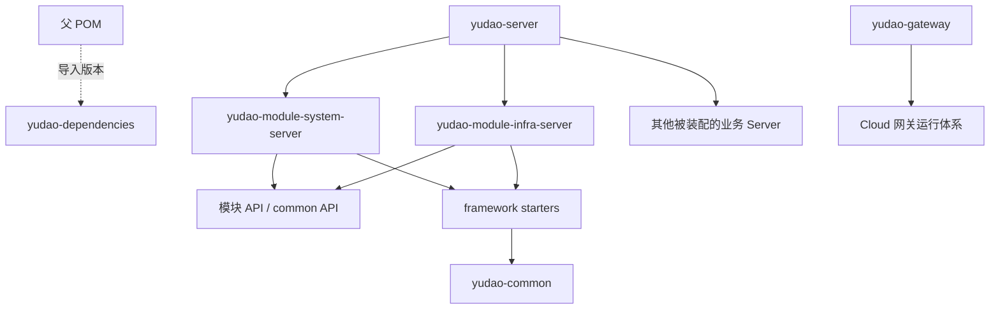

# RuoYi Office 源码架构审查与 Sail Admin 改造

## 来源与审查边界

参考仓库：<https://github.com/yuqing2026/ruoyi-office>。本地快照位于 `D:/exploitation/project/ruoyi-office`，来源分支 `master-jdk17`，基准提交 `ad56d726368d8c321644d47898a76d3e86f1b548`。下载的是该版本源码压缩快照，没有克隆完整 Git 历史。

本次静态读取全部 79 份 Maven POM 的模块与直接依赖，并核对认证、数据权限、文件、支付通知、自动配置及单体装配的核心实现。完整声明清单见 [上游 Maven 清单](upstream-maven.md)。该结论针对基础框架改造；OA、ERP、商城、AI 等全量业务实现及前端没有逐行审计，不将其作为已经审查并迁移的功能。上游源码没有被修改。

## 原始结构与职责

```text
ruoyi-office/
├── pom.xml                      # 父工程、插件、boot/cloud profiles
├── yudao-dependencies/           # BOM、第三方版本、内部模块管理
├── yudao-framework/              # common 与多种 Spring Boot starter
├── yudao-server/                 # 单体启动装配
├── yudao-gateway/                # 微服务网关
├── yudao-module-system/          # 用户、组织、权限、消息等通用系统能力
├── yudao-module-infra/           # 文件、配置等基础业务
├── yudao-module-pay/             # 支付、退款、通知等
├── yudao-module-{oa,hrm,bpm,...}/ # 独立扩展业务，各自 API/Server
├── yudao-ui/                     # 前端入口
├── sql/                          # 多种数据库脚本及补丁资料
└── LICENSE
```

根 POM 使用 `cn.iocoder.cloud` 和 `${revision}`，基准为 `2026.01-SNAPSHOT`；JDK 17、Spring Boot 3.5.9。插件统一管理编译、注解处理、Surefire、flatten；依赖由独立 BOM 导入，根工程同时包含大量非首期业务。

`boot` profile 设置 `skip.repackage=true`，业务子模块作为普通库供单体装配；`cloud` 默认激活，设置 `skip.repackage=false`，配合各业务启动入口打包。`yudao-server/pom.xml` 通过依赖业务 Server 装配单体。不能只改根 Java 版本和 Boot BOM，就假定全部 starter 与 RPC 自动配置已经兼容 Boot 4。



全部 POM 顶层直接项目依赖图未发现环；这不是 effective-POM 或 Spring Bean 循环的证明。例如支付通知实现中存在 `@Lazy` 依赖，需要与 Maven 依赖环分开判断。

## 核心实现与改造决策

| 检查点 / 源码依据 | 上游实际实现 | Sail Admin 决策 |
| --- | --- | --- |
| 根 POM、`yudao-dependencies/pom.xml` | 父工程加独立 BOM，兼有 Cloud/Alibaba 与广泛业务版本 | 保留独立 BOM、聚合分层；统一 `sail` 坐标，使用正式版本，去掉首期无用的 Cloud 依赖 |
| `yudao-module-system-api/.../permission/PermissionApi.java` | API 继承 common API，并带 `@FeignClient` 和 Spring MVC 注解 | 首期 API 使用普通 Java 接口/记录，HTTP 放 Server，真正拆服务时再加远程适配 |
| `...starter-security/.../YudaoSecurityAutoConfiguration.java` | Spring Security、BCrypt、权限 API 桥接等 | 按目标栈使用 Sa-Token Boot 4；仅密码算法依赖 Spring Security Crypto，不装配第二套过滤器链 |
| `...starter-biz-data-permission/.../DeptDataPermissionRule.java` | 通用数据权限规则与数据库拦截器 | 首期用户查询显式注入五种范围，避免把通用 SQL 改写框架整体搬入 |
| `...starter-web/.../GlobalExceptionHandler.java` | 全局异常、业务错误与统一响应 | 重新实现最小错误响应和追踪号，不把原始 SQL、参数、密钥返回客户端 |
| `...module-infra/.../file/FileServiceImpl.java` | 配置编号关联文件；客户端抽象；部分上传使用 byte[] | 保留“文件关联原配置”原则；新实现流式上传下载、本地原子写入和服务端文件归属校验 |
| `...module-pay/.../notify/PayNotifyServiceImpl.java` | 通知任务先持久化、事务后执行、重试与锁，含租户和异步线程配置 | 保留持久化和幂等思想；使用本地业务接口、数据库租约与批次补偿，不引入租户/远程通知复杂度 |
| framework 下 `AutoConfiguration.imports` | starter 按 Spring 自动配置机制加载 | 每个基础设施模块保留独立自动配置，明确装配范围 |
| Redis/WebSocket starter | 多种 Redis 业务能力及独立 WebSocket 支持 | Redis 用于登录、短期票据和跨实例变更信号，数据库保存消息事实 |

## 复用、重构与不引入的内容

可以参考的主要是模块边界、BOM、API/Server 分层、文件配置关联、通知持久化与重试原则。当前 Sail Admin 业务代码为重新实现，不能把原项目功能清单当成已移植的能力。

直接迁移前需要重构的内容包括 Java 包名、坐标、扫描路径、Boot 3 starter 自动配置、Feign/API 注解耦合、旧 Jackson/Servlet 兼容点，以及租户上下文和业务之间的依赖。上游将多种通用 API 放入 common 的方式不全量沿用；Sail 的跨模块业务契约各自归属对应 API 模块。

首期不引入网关运行框架、Nacos、Feign、XXL Job、租户拦截器、社交登录、钱包、转账、商城、工作流及第三方框架覆盖类。保留已有上游作为只读参考，不通过删除其业务模块完成瘦身，而是在独立 Sail 工程中仅装配已确认能力。

## 技术兼容与授权

Sail BOM 指定 JDK 21、Boot 4.0.9、MyBatis-Plus Boot 4 Starter 3.5.18、Sa-Token Boot 4 Starter 1.46.0；没有用 Boot 3 starter 冒充 Boot 4 适配。依赖坐标与较早源码构建已有历史证据，但后续源码变更后按用户要求未再编译，最终兼容/运行验收状态见 [交付记录](delivery-status.md)。

上游根 LICENSE 是 MIT，版权为 `Copyright (c) 2021 yudao-cloud`；原文保留于 `licenses/ruoyi-office-MIT.txt`。MIT 允许按许可条件修改、分发、商业使用，需要保留版权与许可文本。上游的名称、图片、文档素材及各依赖不能自动推断为同一授权；最终发布依赖还需要按各自 LICENSE/NOTICE 核对。当前没有对全部传递依赖完成法律合规审计。

## 推荐实施结果

采用独立 Maven 模块化单体；基础设施下沉到 framework，系统/消息/文件/支付各自保持 API 与 Server；单体只负责装配；支付和云存储在实际调用时使用明确配置。按当前确认范围交付源码和本地配置，真实运行验收留待具备环境并获得执行指示后开展。
